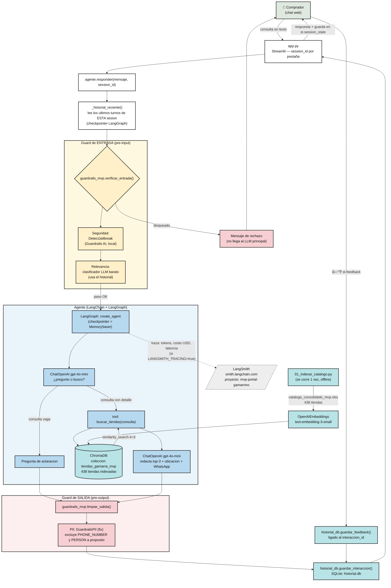

# Portal Gamarrino AI — MVP: arquitectura y tecnologías

*Documenta el prototipo real en `MVP_Portal_Gamarrino/`, construido sobre los resultados de la evaluación offline de E5 (`Muestra_378_Evaluacion/`, dentro de este mismo repo).*

## 1. Qué hace el agente

Un comprador escribe en lenguaje natural qué prenda busca. El agente:
1. Decide si la consulta ya tiene suficiente detalle para buscar, o si hace falta una pregunta corta primero (criterio: ¿hay al menos un atributo diferenciador además del tipo de prenda?).
2. Corrige en su propia búsqueda los errores de tipeo obvios del comprador (no repite el typo literal).
3. Busca por **significado** (no por palabra exacta) en el catálogo de 438 tiendas del Emporio de Gamarra.
4. Si ningún resultado supera un umbral mínimo de relevancia, lo dice honestamente y pide más detalle, en vez de presentar coincidencias débiles como si fueran buenas recomendaciones.
5. Devuelve el top-3 de tiendas más relevantes: nombre, por qué calza, ubicación exacta (galería/piso/stand), WhatsApp si existe, link al mapa.
6. Recuerda lo ya dicho en esa misma conversación (género, color, estilo, personaje si es un disfraz) sin que el usuario lo repita.
7. Guarda la consulta + respuesta en una base de datos local, y deja que el comprador vote 👍/👎 sobre si le sirvió.

## 2. Stack tecnológico

| Pieza | Tecnología | Versión instalada | Para qué se usa aquí |
|---|---|---|---|
| Lenguaje | Python | 3.14 | Todo el MVP |
| Orquestación del agente | **LangGraph** | 1.2.18 | `create_agent` (de `langchain.agents`, API unificada de LangChain v1 — construye internamente un `StateGraph` de LangGraph): controla el ciclo "pensar → decidir si llama a una tool → responder", y la memoria conversacional por sesión (`MemorySaver`) |
| Framework LLM | **LangChain** (`langchain`, `langchain-openai`, `langchain-chroma`, `langchain-community`) | 1.4.7 | Capa común que conecta el LLM, el vectorstore y las tools; LangGraph se apoya en sus abstracciones (`ChatOpenAI`, `OpenAIEmbeddings`, `Document`, `@tool`) |
| LLM de chat | OpenAI `gpt-4o-mini` | — (API) | Decide cuándo preguntar vs. buscar, redacta la respuesta final |
| Embeddings | OpenAI `text-embedding-3-small` | — (API) | Mismo modelo que ganó la evaluación offline de E5 (66,9% Hit Rate@3 ponderado vs. 52,9% léxico vs. 46,8% categoría vs. 23,0% azar) |
| Base vectorial | **ChromaDB** | 1.5.9 | Guarda el embedding de cada una de las 438 tiendas; `similarity_search(consulta, k=3)` es la búsqueda real |
| Guardrails | **Guardrails AI** (`guardrails-ai`, `guardrails-ai-detect-jailbreak`, `guardrails-ai-guardrails-pii`) | 0.10.2 / 0.1.6 / 1.0.8 | Seguridad (jailbreak), relevancia, PII — ver sección 5 |
| Observabilidad | **LangSmith** (`langsmith`, viene con `langchain`) | 0.14.14 | Trazas de cada ejecución: tokens, costo estimado, latencia por paso — activado solo por variables de entorno |
| Interfaz | **Streamlit** | 1.66.1 | Chat web en `localhost:8501` |
| Configuración | `python-dotenv` | — | Carga `.env` (API keys) |
| Datos | `pandas` + `openpyxl` | 3.1.0 / 3.1.5 | Leer el catálogo `.xlsx` |
| Persistencia de uso | `sqlite3` (estándar de Python, nada que instalar) | — | `historial.db`: guarda cada consulta + respuesta + feedback (👍/👎) — ver sección 4 y `src/historial_db.py` |

**Por qué LangGraph y no solo LangChain:** LangChain da los componentes (LLM, vectorstore, tools); LangGraph da el **grafo de control** — decide en qué orden se ejecutan esos componentes y persiste el estado de la conversación entre turnos sin que el código tenga que manejarlo a mano. Esta decisión de arquitectura ya estaba tomada desde la fase de diseño del proyecto (confirmada en 2 asesorías), y es el mismo patrón que se usó en el curso de Agentes IA (`Modulo5.../Sesion15_LangGraph_MultiAgent`).

## 3. Estructura de archivos

```
MVP_Portal_Gamarrino/
├── .env                          # OPENAI_API_KEY + LANGSMITH_*
├── requirements.txt
├── agent_profile_card.html       # Ficha del agente (PEAS + autonomía + criticidad)
├── MVP_ARQUITECTURA_Y_TECNOLOGIAS.md   # este archivo
├── chroma_db/                    # indice vectorial persistido (438 tiendas)
├── historial.db                  # SQLite: consultas + respuestas + feedback (se genera, no se sube)
└── src/
    ├── 01_indexar_catalogo.py    # construye chroma_db/ a partir del catalogo .xlsx
    ├── guardrails_mvp.py         # guard de entrada (seguridad + relevancia) y de salida (PII)
    ├── historial_db.py           # guarda cada interaccion + su feedback en historial.db
    ├── agente.py                 # el agente LangGraph + memoria + wiring de guardrails
    └── app.py                    # interfaz de chat (Streamlit), con botones de feedback
```

## 4. Cómo se mueve una consulta por el sistema

### Vista visual

*Se ve renderizado en Obsidian y en GitHub. Si tu visor no soporta Mermaid, el detalle paso a paso equivalente está más abajo.*



- **Verde (entrada):** el usuario escribe en el chat de Streamlit.
- **Amarillo (guard de entrada):** dos chequeos corren ANTES de gastar un solo token en el agente principal — si el mensaje es un intento de jailbreak o está fuera de tema, se corta ahí mismo.
- **Azul (el agente):** LangGraph decide si pregunta o busca; la única herramienta que puede usar es `buscar_tiendas`, que consulta ChromaDB (celeste) — nunca inventa una tienda que no esté ahí.
- **Rojo (guard de salida):** antes de que la respuesta llegue al usuario, se revisa que no filtre datos personales (sin tocar el WhatsApp de la tienda, que sí debe mostrarse).
- **Línea punteada:** LangSmith recibe la traza de observabilidad en paralelo, sin bloquear la respuesta al usuario.
- **Celeste (historial.db):** cada consulta + respuesta se guarda en SQLite antes de llegar al usuario; si el comprador vota 👍/👎, ese feedback se guarda ligado a esa misma interacción.
- **Caja inferior:** la indexación del catálogo en ChromaDB es un paso aparte, offline, que se corre una sola vez (no en cada consulta).

### Paso a paso en detalle (con los nombres de función tal cual están en el código)

1. **`app.py`** — el usuario escribe en el `st.chat_input`. Cada pestaña del navegador tiene su propio `session_id` (`uuid.uuid4()`, guardado en `st.session_state`), así que la memoria de una conversación no se mezcla con otra.
2. **`agente.responder(mensaje, session_id)`** es el punto de entrada único:
   - `_historial_reciente(config)` lee del checkpointer de LangGraph (`agente.get_state(config)`) los últimos turnos de **esa misma sesión** — necesario para que el guardrail de relevancia entienda respuestas cortas de seguimiento ("talla M", "de Drácula").
   - `guardrails_mvp.verificar_entrada(mensaje, historial)` corre las 2 capas de pre-input (ver sección 5). Si alguna bloquea, `responder()` devuelve el mensaje de bloqueo **sin llamar al LLM principal** (ahorra costo y evita que el ataque llegue siquiera al agente).
3. Si pasa, `agente.invoke({"messages": [...]}, config)` entra al grafo de LangGraph (`create_agent`):
   - El LLM (`gpt-4o-mini`, con el `SYSTEM_PROMPT` del dominio) decide: ¿la consulta ya tiene al menos un atributo diferenciador (color, talla, estilo, ocasión, personaje) además del tipo de prenda? Si no, responde directo con una pregunta corta. Si sí, invoca la tool — corrigiendo en el texto de búsqueda los typos obvios del comprador (la búsqueda semántica interpreta mal un error de tipeo literal, así que no se repite tal cual).
   - **`buscar_tiendas(consulta)`** (la única tool): llama a `similarity_search_with_relevance_scores(consulta, k=3)` sobre `_vectorstore`, la colección `tiendas_gamarra_mvp` en ChromaDB. Si el mejor score no supera `UMBRAL_RELEVANCIA = 0.15` (calibrado empíricamente con 4 consultas reales, no es una cifra científica), devuelve `"BUSQUEDA_SIN_RESULTADOS_CONFIABLES"` en vez de tiendas — así el LLM pide más detalle en lugar de presentar coincidencias débiles como recomendación. Si pasa el umbral, devuelve nombre, categoría, ubicación y WhatsApp (o "no disponible") de las 3 tiendas más parecidas.
   - El LLM recibe el resultado de la tool y redacta la respuesta final en español, sin inventar stock/talla/precio (instrucción explícita del `SYSTEM_PROMPT`), sin frase de cierre tipo "¡espero que...!" (recorte para ahorrar tokens de salida).
   - `MemorySaver` guarda automáticamente este turno bajo el `session_id`, para que el siguiente mensaje de la misma sesión tenga memoria.
4. **`guardrails_mvp.limpiar_salida(respuesta)`** corre el guardrail de pre-output (PII) antes de devolver el texto.
5. **`historial_db.guardar_interaccion(...)`** guarda la consulta + respuesta en `historial.db` (SQLite) y devuelve un `interaccion_id`. Esto corre siempre, incluso si el mensaje fue bloqueado por un guardrail — útil para medir cuántas veces se activan.
6. **`app.py`** muestra la respuesta en el chat, la guarda en `st.session_state.historial` junto con su `interaccion_id` (memoria del lado de la interfaz, para redibujar el chat completo en cada rerun de Streamlit), y dibuja los botones `st.feedback("thumbs")`. Si el comprador vota, `historial_db.guardar_feedback(interaccion_id, valor)` lo graba ligado a esa interacción exacta.
7. **En paralelo, sin que el código lo pida explícitamente:** si `LANGSMITH_TRACING=true` en `.env`, LangChain envía la traza completa de ese `invoke()` (cada llamada al LLM, la llamada a `buscar_tiendas`, tokens de entrada/salida, costo estimado en USD, latencia por paso) a LangSmith. Cero instrumentación manual — es el mismo patrón que `CONECTAR_LANGSMITH.md` de tu curso (Módulo 5 / Sesión 12).

## 5. Guardrails (detalle — código completo en `src/guardrails_mvp.py`)

Arquitectura en capas (taxonomía de OpenAI vista en el curso, `Módulo3/Sesión07/clase7/e4-guardrails-en-capas`):

```
usuario -> [guard_entrada] -> agente (LLM + tool) -> [guard_salida] -> usuario
            DetectJailbreak                            GuardrailsPII (fix,
            relevancia (LLM barato)                     sin PHONE_NUMBER
                                                          ni PERSON)
```

| Capa | Categoría (taxonomía OpenAI) | Implementación | Estado verificado |
|---|---|---|---|
| Seguridad | pre-input | `DetectJailbreak` de Guardrails AI, corre 100% local (3 modelos propios descargados con `post_install`, no llama a ninguna API externa) | **Activo, con límite real:** detectó el ataque de prueba en inglés; no detectó 2 de 2 variantes del mismo ataque en español. Documentado también en el curso (Sesión 24: "lo evaden... payloads multilingües"). |
| Relevancia | pre-input | Clasificador propio (una llamada barata a `gpt-4o-mini`), usa el historial de la sesión | **Activo.** Corregido un falso positivo real antes de producción: bloqueaba "De Drácula" (seguimiento corto) por no tener contexto; ahora sí lo tiene. |
| Tool safeguards | gate intermedio | `buscar_tiendas` es de solo lectura, no escribe ni ejecuta nada irreversible | Evaluado: riesgo bajo, no necesita pausa/escalación por diseño |
| PII | pre-output | `GuardrailsPII` (`on_fail="fix"`), entidades: `EMAIL_ADDRESS, US_SSN, CREDIT_CARD, ES_NIF` | **Activo.** Excluye a propósito `PHONE_NUMBER` (el WhatsApp de la tienda es dato de negocio que el agente debe mostrar) y `PERSON` (el detector de nombres confundía listas tipo "¿hombre, mujer o niño?" con nombres propios y las tachaba como `<PERSON>`, rompiendo la respuesta — solo pasa en formato lista, no en una oración normal). |
| Moderación | pre-output | `BiasCheck` de Guardrails AI | **Pendiente.** Necesita TensorFlow, que falla en este equipo por tener desactivado el "Long Path Support" de Windows. Instrucciones de activación en el `README.md`. |

## 6. Observabilidad (LangSmith)

Se activa solo con 3 variables en `.env` (`LANGSMITH_TRACING`, `LANGSMITH_API_KEY`, `LANGSMITH_PROJECT=mvp-portal-gamarrino`), cero cambios de código — LangChain/LangGraph instrumentan automáticamente cada `agente.invoke(...)`. En [smith.langchain.com](https://smith.langchain.com), proyecto `mvp-portal-gamarrino`, cada fila es una consulta real: árbol completo (mensaje → decisión del LLM → tool → respuesta), tokens de entrada/salida, costo estimado en USD y latencia por paso — útil para ver si el cuello de botella es el modelo o la búsqueda en Chroma.

## 7. Limitaciones conocidas (verificadas, no supuestas)

- **Hit Rate@3 = 66,9%** (ponderado, IC 95% [61,9%–71,4%]): 1 de cada 3 consultas no encuentra tienda relevante en el top-3. Peor en consultas con marca/talla/precio explícito (20,0% de acierto) que en consultas con prenda específica (79,6%) — detalle completo en el Model Card de E5.
- **`DetectJailbreak` no cubre español de forma confiable** (verificado con pruebas reales, sección 5).
- **`guardrails-ai-detect-prompt-injection` no se pudo instalar**: depende de `rebuff>=0.1.1`, que requiere Python <3.13 y este venv usa 3.14. La capa de seguridad depende solo de `DetectJailbreak`.
- **`BiasCheck` (moderación) pendiente** de que se habilite Long Path Support en Windows.
- **`UMBRAL_RELEVANCIA = 0.15` es un corte empírico con poca evidencia** (4 consultas de prueba), no una cifra validada — puede necesitar recalibrarse con más tráfico real. Si se nota muy estricto (rechaza búsquedas válidas) o muy laxo (deja pasar basura), este es el primer lugar a revisar.
- **El catálogo tiene poco inventario de disfraces de personaje**: "disfraz de Drácula" no supera el umbral de relevancia (mejor score real: 0,088) — es una limitación de los datos de Gamarra, no del buscador.
- **Sin memoria conversacional entre sesiones distintas**: cada `session_id` nuevo (ej. otra pestaña del navegador) arranca sin historial de chat previo. `historial.db` sí es almacenamiento persistente real (sobrevive reinicios), pero es un registro para análisis — el agente no lo relee durante la conversación.
- **Sin fotos de tienda**: H4 (fotos) sigue sin resolverse a nivel de datos — el catálogo no trae `photo_urls`.
- **Sin autenticación**: cualquiera con acceso a `localhost:8501` puede usarlo. Aceptable para un prototipo académico corriendo en local; no apto para exponerlo a internet tal cual.

## 8. Cómo correrlo

Ver `README.md` (pasos de PowerShell con el venv). Resumen: `python src/01_indexar_catalogo.py` una vez, luego `streamlit run src/app.py`.
